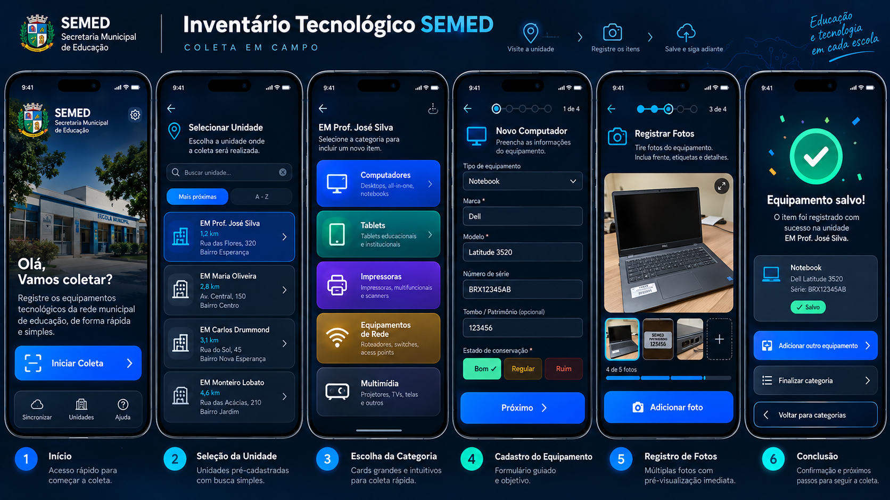

**Manutenção e transferência atuais:** [docs/07-operacao](../07-operacao/README.md), com arquitetura, ambiente, dados, publicação, backup e migração (D-063).

# Índice de documentação — leia por objetivo

| Pergunta | Documento canônico |
|---|---|
| O que foi decidido? | [DECISOES.md](DECISOES.md) |
| O que ainda falta decidir? | [PENDENCIAS.md](PENDENCIAS.md) |
| Como registrar uma mudança? | [PROTOCOLO_DE_ATUALIZACAO.md](PROTOCOLO_DE_ATUALIZACAO.md) |
| Onde está a fonte original? | [Base de Coleta v1.0](../02-coleta-mobile/BASE_DE_COLETA_V1_0_ORIGINAL.txt) |
| Como é a coleta no celular? | [INTERFACE_E_FLUXOS.md](../02-coleta-mobile/INTERFACE_E_FLUXOS.md) |
| O que cada grupo A-H coleta? | Base original, seções 4.A–4.H |
| Como é o painel? | [ESPECIFICACAO_DE_INTERFACE.md](../03-painel-desktop/ESPECIFICACAO_DE_INTERFACE.md) |
| Quais PNGs foram aprovados? | [MANIFESTO_REFERENCIAS.md](../../design/MANIFESTO_REFERENCIAS.md) |
| Como os dados se relacionam? | [MODELO_CONCEITUAL.md](../04-dados-apis/MODELO_CONCEITUAL.md) |
| Como o Codex comprova o trabalho? | [ACEITE.md](../05-qualidade/ACEITE.md) |

## Referências visuais embutidas

A aparência é obrigatória enquanto **as informações textuais dos mockups são ilustrativas** e não prevalecem sobre o questionário consolidado.
