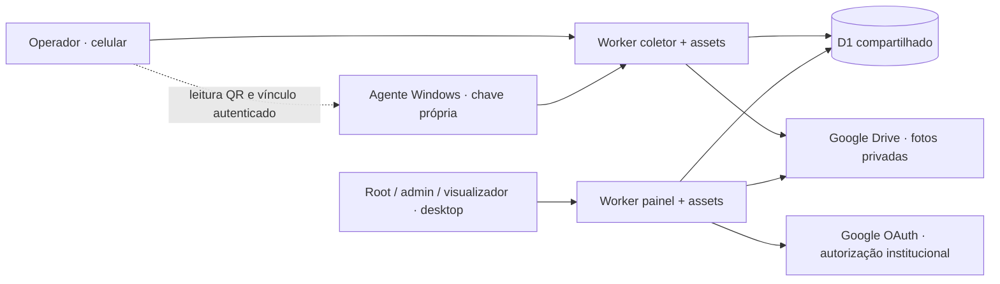

# Arquitetura atual

Ambas as publicações usam `server/worker.mjs`. `APP_KIND=collector` seleciona a coleta e restringe rotas administrativas. Não separar os bancos: o desktop precisa consultar a mesma visita gravada pelo coletor.

| Responsabilidade | Arquivos |
|---|---|
| Login, sessão, CSRF, roteamento | `server/worker.mjs`, `server/security.mjs` |
| Unidades, importação, exclusão | `server/units.mjs`, `web/admin-units.js`, `unit-schema.js` |
| Visitas, respostas, equipamentos, publicação | `server/collector.mjs` e auxiliares |
| Imagens/OAuth | `server/photo-storage.mjs` e módulos Google |
| Identidade/telemetria | `server/agentes/` |
| Coletor atual | `web/collector-v3.*`, `collector-drafts.js`, `collector-ui.js`, `collector-qr.js` |
| Compatibilidade | Esquemas V3, V2, original e `visit-schema.js` |
| Consultas desktop | `web/desktop*.js`, `desktop-progress*`, `desktop-results.js`, `desktop-inventory.js`, `desktop-agents.js` |
| Mapa | `web/desktop-map.js`, `map-geography.js`, `web/data/`, Leaflet |
| Build | `scripts/build-desktop.mjs`, `build-collector.mjs` |

HTML/CSS/JS nativos; sem framework de componentes. Os builds copiam listas explícitas de assets. Arquivo novo em `web/` não entra automaticamente no pacote. Fluxos anteriores permanecem para retomada de visitas existentes; não removê-los só porque a entrada usa o questionário atual.

## Resposta → painel

1. Conta autenticada seleciona unidade oficial ativa. Operador não cria escola.
2. Visita e assunto possuem IDs/versões. Navegação pode avançar enquanto a fila em memória envia alterações.
3. Worker valida conteúdo, usuário, versão e permissões; D1 recebe dados e histórico.
4. Desktop consulta parciais já confirmados, rotulados PARCIAL; atualização atual de 15 segundos e ação manual.
5. Concluir assunto e publicar visita são ações diferentes. Indicadores oficiais dependem da publicação aceita pelo servidor.

Digitação não salva não é dado recebido. A fila da aba não é offline durável.

## Foto → painel

Câmera/galeria → preparo no navegador → upload autenticado com visita/alvo → Worker → Drive privado → confirmação e metadados no D1 → consulta autenticada no painel. Prévia local não prova envio. Preservar também a fila de exclusões do provedor ao restaurar.

## Computador → unidade

Agente Windows cria identidade assinada e cadastro técnico pendente, recebe QR temporário; operador autenticado associa unidade/ambiente/posição. Depois chegam inventário e heartbeat. Localização é informação humana. Cadastro automático não publica ficha escolar e não dispensa autenticação do vínculo.

## Dependências externas

Cloudflare Workers/D1; Google OAuth/Drive; tiles de ruas/satélite em `desktop-map.js`; API Pwned Passwords para verificar novas senhas por prefixo de hash; navegadores HTTPS/câmera e conectividade dos agentes. Preservar atribuição/licenças dos mapas e bibliotecas.

Falha de tiles não significa perda do banco; login SEMED funcional não prova que OAuth/Drive estejam saudáveis. Monitorar integrações separadamente.
