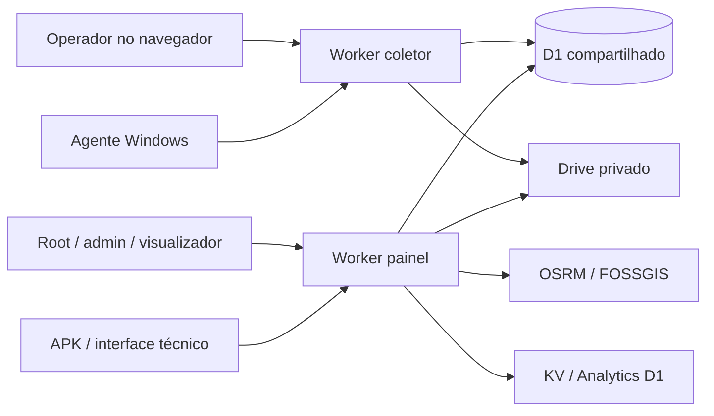
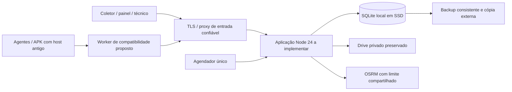

# 01 · Topologia e escolhas de arquitetura

## ATUAL: dois hosts, um banco, três experiências humanas

Entrada dos dois Workers: `server/worker.mjs`. `APP_KIND=collector` restringe o aplicativo da coleta. Não criar uma cópia independente de banco por host. As sessões são separadas, mas hashes de usuário e dados de inventário são os mesmos. Técnico é interface exclusiva de atendimento no painel, não outro coletor.

## PROPOSTA inicial: migração conservadora em duas etapas

1. Manter SQL/IDs/Drive e lógica de negócio. Criar servidor HTTP Node 24, adaptador compatível com D1 usando SQLite local, serviço de tarefas e proxy TLS. Os dois domínios humanos continuam apontando para a mesma persistência, com contexto de aplicação separado.
2. Após operação estável e carga medida, decidir se há motivo para PostgreSQL, armazenamento físico de fotos ou retirada completa da borda Cloudflare. Cada mudança posterior tem backup, homologação e corte próprios.

Este desenho não é infraestrutura já criada. A ponte é opcional e depende de implementação/aceite; não basta mudar DNS, pois `workers.dev` pertence à Cloudflare. Ela deve encaminhar ao **mesmo único backend escritor** que atende os domínios novos. Não manter um banco D1 gravando paralelamente a um SQLite físico independente.

## Opções de banco

| Opção | Vantagem | Trabalho/limite | Recomendação nesta análise |
|---|---|---|---|
| SQLite local | Mesmo dialeto básico, permite preservar migrações e várias consultas | Adaptador D1 obrigatório; um escritor por vez, latência de disco e filas precisam ser medidas | Primeiro candidato para ensaio |
| PostgreSQL | Melhor isolamento para múltiplos escritores e operação de banco dedicado | Converter SQL JSON, tipos, triggers, views, índices, guardas e códigos de erro; dupla validação semântica | Avaliar se carga/disponibilidade justificarem |
| D1 mantido | Menor mudança imediata | Continua sujeito à franquia/plataforma atual | Caminho de continuidade durante preparação |

SQLite em WAL permite leitores enquanto há escrita, mas os processos precisam estar no mesmo host; não colocar o arquivo em compartilhamento SMB/NFS. Isso não transforma SQLite em múltiplos escritores simultâneos. [Referência SQLite WAL](https://sqlite.org/wal.html).

Para a primeira prova, propor um processo lógico escritor/serviço de banco e conexões controladas. Não iniciar vários processos Node escrevendo livremente por PM2/cluster sem testar serialização, transações e limites. SQLite e PostgreSQL não são escolhas de interface: não precisam mudar a identidade visual nem o questionário.

## Borda, domínio e internet

- **Cloudflare como entrada/ponte:** conserva compatibilidade de hosts antigos e pode fornecer metadados confiáveis de IP/ASN. Mantém dependência e limites do Worker usado como ponte, mesmo que retire o consumo D1.
- **Entrada direta no servidor:** exige domínio administrável, HTTPS, firewall, endereço alcançável e atualização de clientes fixos. Provedor/ASN precisa de mecanismo próprio; não existe `request.cf` no Node.
- **Tunnel:** opção de conexão de saída entre servidor e Cloudflare, útil quando não há porta de entrada acessível. Não substitui domínio, segurança da aplicação, backups ou adaptação do runtime. [Documentação Cloudflare Tunnel](https://developers.cloudflare.com/cloudflare-one/networks/connectors/cloudflare-tunnel/).

Não se escolhe uma dessas alternativas apenas pela existência de e-mail institucional. Precisamos comprovar quem administra DNS/domínio e rede. Um e-mail `@pacodolumiar.edu.ma.gov.br` não implica permissão para criar subdomínios.

## O que deve permanecer igual

IDs, conta/pepper, permissões, fotos privadas, callbacks autorizados, assinatura do agente, autoria/histórico, parciais, manual de conclusão, demandas, localização efêmera, ordem do root, cron e prazos aprovados. Os componentes de plataforma podem mudar; as regras de negócio não são redefinidas por esta análise.
